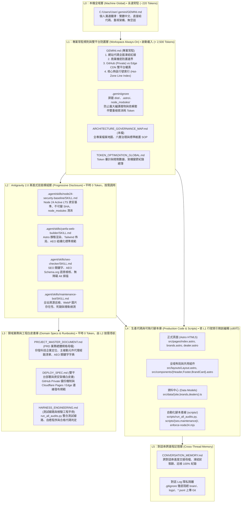

# 仰發科技專案架構、規範、雙平台安全邊界與檔案分層治理總簿 (`ARCHITECTURE_GOVERNANCE_MAP.md`)

> **文件位階**：專案最高全域導覽母檔 (Project Master Architecture & File Governance Map)  
> **適用標準**：Google Antigravity 2.0 原生客製化規範 + `GEMINI.md` 階層規範 + `.agent/skills/` 漸進式揭露  
> **發布端點**：GitHub (Private Security Zone) ＋ Cloudflare Pages / Edge CDN (`https://www.yanfa.com.tw/`)  
> **連動母檔**：[GEMINI.md](./GEMINI.md) ｜ [DEPLOY_SPEC.md](./DEPLOY_SPEC.md) ｜ [HARNESS_ENGINEERING.md](./HARNESS_ENGINEERING.md) ｜ [PROJECT_MASTER_DOCUMENT.md](./PROJECT_MASTER_DOCUMENT.md)  
> **最後更新**：2026-11-05

---

## 一、架構理念：資深 IT 與工程素養防禦縱深

本專案為 **仰發科技有限公司官方網站 (Website-yanfa.com.tw)**，專案主持與維運系統負責人為資深 IT 專家，全專案徹底杜絕業餘開發行為，以嚴格的六層架構（L0 至 L5）落實「小心翼翼、零機密洩漏、守護技術聲譽、雙平台權責分離」之專業精神。

---

## 二、全專案檔案矩陣與職責清冊

### 1. 規則、部署與工程規範 (Rules & Deployment)
| 檔案路徑 | 層級 | Antigravity 載入行為 | 主要職責 |
| :--- | :--- | :--- | :--- |
| `C:\Users\User\.gemini\GEMINI.md` | **L0** | 永遠全域載入 | 個人對話習慣：繁體中文、專家溝通、直接代碼。 |
| [GEMINI.md](./GEMINI.md) | **L1** | **專案常駐載入** | 專案總體規則：代碼凍結、商業機密防火牆、熱區行號索引。 |
| [.geminiignore](./.geminiignore) | **L1** | 搜尋引擎前置過濾 | 隔離 `dist/`、`.astro/`、`node_modules/`，杜絕 Token 浪費。 |
| [ARCHITECTURE_GOVERNANCE_MAP.md](./ARCHITECTURE_GOVERNANCE_MAP.md) | **L1** | 專案導覽母檔 | 全案件檔案地圖、六層架構圖、職責矩陣與標準維護程序。 |
| [TOKEN_OPTIMIZATION_GLOBAL.md](./TOKEN_OPTIMIZATION_GLOBAL.md) | **L1** | 治理日誌 | 記錄專案架構盤點、Token 精簡數據與歷次架構升級紀錄。 |
| [DEPLOY_SPEC.md](./DEPLOY_SPEC.md) | **L3** | 部署白皮書 | GitHub Private 與 Cloudflare Pages / Edge 雙平台職責分離與安全配置。 |
| [HARNESS_ENGINEERING.md](./HARNESS_ENGINEERING.md) | **L3** | 測試工程手冊 | 自動化測試線路、SEO/AEO 檢驗標準、資安標頭防線。 |

---

### 2. 漸進式技能層 (Progressive Disclosure Skills)
位於 `.agent/skills/`，平時僅注入 `name` 與 `description`（零 Token 負擔），依需求自動展開：

| 技能目錄 | 觸發時機 | 關聯腳本與目標 |
| :--- | :--- | :--- |
| `node24-security-baseline` | CI/CD 修改、套件安裝、版本審查 | `scripts/enforce-node24.mjs` 強制 Node 24 執行期與清消 |
| `yanfa-web-builder` | 網站頁面維護、Astro 元件調整、AEO 優化 | `PROJECT_MASTER_DOCUMENT.md`、`src/` 程式庫 |
| `seo-checker` | 檢核產業關鍵字、AEO Schema.org 語意 | `scripts/seo/check_seo.py` 產出 `SEO_REPORT.md` |
| `maintenance-bot` | 檢核內部壞軌、圖檔遺失、外部連結 | `scripts/maintenance/check_site.py` 產出 `MAINTENANCE_REPORT.md` |

---

### 3. 業務資料與生產代碼 (Domain Data & Production Code)
| 檔案路徑 | 層級 | 說明 |
| :--- | :--- | :--- |
| [PROJECT_MASTER_DOCUMENT.md](./PROJECT_MASTER_DOCUMENT.md) | **L3** | **專案最高業務規格書**：仰發科技公司定位、代理品牌陣容、經銷服務項目、AEO 關鍵字字典。 |
| `src/data/site.ts` | **L4** | 公司名稱、地址、電話、統編與全域導覽連結設定。 |
| `src/data/brands.ts` | **L4** | 9 大代理品牌資料庫（冠寶、義發、尼克森、友順、佳展、德微、邁斯、華太、瞻芯）。 |
| `src/data/dealers.ts` | **L4** | 5 大國際經銷夥伴資料庫（Littelfuse、Nichicon、Nippon Chemi-Con、Panasonic、Toshiba）。 |
| `src/layouts/Layout.astro` | **L4** | 核心佈局，內建 Anti-Clickjacking Frame-Busting、CSP 安全標頭、GA4 與 Schema.org JSON-LD。 |
| `src/pages/*.astro` | **L4** | 正式發布頁面（首頁、代理品牌、經銷服務）。 |
| `scripts/run_all_audits.py` | **L4** | 一鍵整合全站檢測流水線（Node 24、Astro Build、SEO/AEO、資源巡檢）。 |

---

### 4. 自動化維運工具 (Maintenance Tooling)
| 批次檔路徑 | 作用 |
| :--- | :--- |
| `backup.bat` | 建立專案 Git Bundle 鏡像與源碼壓縮包至 `..\Website-yanfa-Backups`。 |
| `deploy_github.bat` | 一鍵執行前置測試、Git Add、Commit 與 Push。 |
| `preview.bat` | 啟動本機 Astro 開發預覽伺服器 (`http://localhost:4321/`)。 |
| `stop.bat` | 終止運行中之 Astro/Node 本地預覽進程。 |

---

## 三、標準變更與維護 SOP

1. **規格先行 (Spec-First)**：
   - 任何產品型錄更新、代理品牌異動，必須先於 `PROJECT_MASTER_DOCUMENT.md` 定案確認，方可異動 `src/data/` 或頁面。
2. **切片微創 (Micro-Slice Edit)**：
   - 先查閱 `GEMINI.md` 之行號索引，以 `read_file(StartLine, EndLine)` 讀取指定行區間（≤ 80 行），使用 `edit_file` 精準置換。
3. **推前必檢 (Audit-Before-Push)**：
   - 每次提交前必須執行 `python scripts/run_all_audits.py`，保持全站 0 壞軌、0 遺失、SEO 100% 通過。
