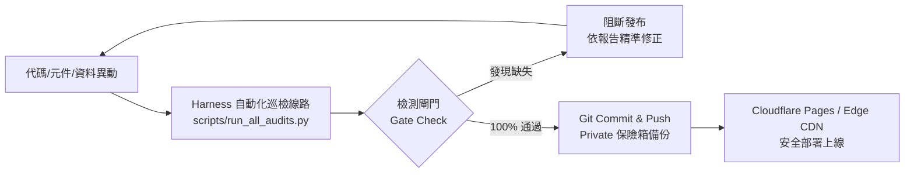

# 專案線路測試、靜態檢測與自癒工程手冊 (`HARNESS_ENGINEERING.md`)

> **文件位階**：自動化驗證與軟體工程線路手冊 (L3 Engineering Spec)  
> **連動腳本**：`scripts/run_all_audits.py` ｜ `scripts/seo/check_seo.py` ｜ `scripts/maintenance/check_site.py` ｜ `scripts/enforce-node24.mjs`  
> **最後更新**：2026-11-05

---

## 一、工程背景：拒絕業餘行為，落實 Harness 軟體工程驗收

在成熟的企業 IT 系統架構中，任何網站推上生產線前，都必須具備**完整的測試線路（Test Harness）**。  
本專案絕不允許「改完 code 就直接 push，結果外網破圖、404 或 SEO 缺少」的非專業行為。所有程式碼、資料檔與靜態圖片，皆由本地自動化腳本實施四重管線檢測：



---

## 二、第一道檢測線：Node 24 Active LTS 資安基準守門 (`enforce-node24.mjs`)

### 1. 檢驗目標與合格標準
- **檔案路徑**：`scripts/enforce-node24.mjs`
- **掃描維度**：
  1. **執行期版本檢驗**：強制執行環境主版本為 Node 24（`majorVersion >= 22`，全面棄用已 EOL 之 Node 18 與 Node 20）。
  2. **node_modules 第三方殘留清消**：遞迴掃描套件內部殘留之 Dockerfile 與 GitHub Actions 工作流設定，統一覆蓋為 Node 24，杜絕軟體供應鏈弱點。

---

## 三、第二道檢測線：Astro 生產靜態編譯驗證 (`npm run build`)

### 1. 檢驗目標與合格標準
- 確保所有 Astro 頁面 (`src/pages/*.astro`)、組件 (`src/components/*.astro`)、資料模型 (`src/data/*.ts`) 與 Tailwind CSS 無語法錯誤。
- 產出純靜態 `dist/` 目錄，確認所有路由均正確產出對應 HTML 實體。

---

## 四、第三道檢測線：SEO 關鍵字與 AEO 結構化資料審核 (`check_seo.py`)

### 1. 檢驗目標與合格標準
- **檔案路徑**：`scripts/seo/check_seo.py`
- **掃描範圍**：`dist/*.html`（全站所有發布頁面）
- **四大檢核維度**：
  1. **Title 標籤**：長度符合標準，包含仰發科技品牌與專業定位。
  2. **Meta Description 描述**：完整呈現公司代理經銷主被動元件核心產品。
  3. **AEO Schema.org 語意標記**：
     - 全站頁面注入 JSON-LD，涵蓋 `@type: "Organization"`、`@type: "WebSite"`、`@type: "PostalAddress"` 與 `@type: "ContactPoint"`，奪取 AI 答案引擎（AEO）推薦排名。
  4. **圖片 Alt 屬性**：全站所有 `` 標籤必須具備非空的 `alt` 說明，無障礙與 SEO 達成率 100%。
- **輸出報告**：自動產生 `SEO_REPORT.md`。

---

## 五、第四道檢測線：全站資源與連結完整度巡檢 (`check_site.py`)

### 1. 檢驗目標與合格標準
- **檔案路徑**：`scripts/maintenance/check_site.py`
- **掃描維度**：
  1. **靜態資源解析**：驗證所有 `.webp` 圖檔、CSS 樣式表、JavaScript 腳本、Favicon 於 `dist/` 或 `public/` 實體存在。
  2. **內部路由查核**：確認 `/`、`/brands/`、`/dealer/` 內部跳轉無任何 404 死鏈。
  3. **外部原廠連結檢驗**：發起安全 HTTP 探測，過濾無效超連結。
- **輸出報告**：自動產生 `MAINTENANCE_REPORT.md`。

---

## 六、一鍵執行與自癒程序

在終端機中僅需一行指令即可完成整套線路測試：

```bash
python scripts/run_all_audits.py
```

### 檢驗回傳代碼標準：
- **Exit Code 0**：全站 100% 通過，各項指標符合資深 IT 架構規範，可安全執行 `deploy_github.bat` 或 `git push`。
- **Exit Code 1**：發現壞軌、遺失圖檔或資安違規，終端機立即阻斷發布並輸出具體檔案與行號供排查。
