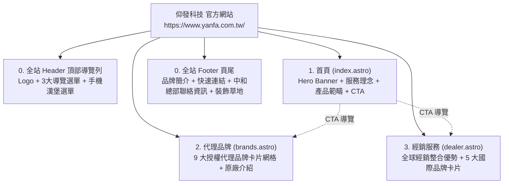

# 仰發科技有限公司官方網站
# 企業官網完整建置與架構規格書 (Website Specification)

> **專案名稱**：仰發科技有限公司企業官方網站 (Website-yanfa.com.tw)  
> **網站正式名稱**：仰發科技 (Yanfa Technology Co., Ltd.)  
> **技術架構**：Astro 4.x + Tailwind CSS 3.x + Node 24 Active LTS + WebP 最佳化  
> **正式網域**：`https://www.yanfa.com.tw/`  
> **核心精神**：專業半導體及電子零件代理與經銷商・服務至上・您的需求最優先  
> **文件狀態**：**已與線上完成之正式網站代碼庫 (Website Codebase) 100% 精準對齊**  
> **商業機密邊界**：**內部產品報價、客戶進貨成本、原廠代理合約未公開細節與採購毛利純屬商業機密，一律不登載於公開網站與外網部署產物。**

---

## 一、網站架構與頁面拓撲 (Site Architecture)

全站採取單一責任多頁面架構 (MPA)，全站頁尾 (Footer) 完整整合中和總部聯絡資訊、Google Maps 嵌入與版權宣告，導覽結構清晰且全頁面具備 AEO 結構化語意標記：

---

## 二、全站共通組件規格 (Global Components)

### 2.1 頂部導覽列 (Header & Navbar)
* **實作組件**：`src/components/Header.astro`
* **品牌識別**：
  * 左側：仰發科技官方主標誌 `src/assets/logos/site-logo.webp`。
* **導覽選單與路由 (Navigation Routing)**：
  1. **關於我們 / 首頁** (`/`)
  2. **代理品牌** (`/brands/`)
  3. **經銷服務** (`/dealer/`)
* **行動端適配**：響應式漢堡選單（Hamburger Button），點擊任一選單連結自動關閉展開選單。

---

### 2.2 全站頁尾 (Footer)
* **實作組件**：`src/components/Footer.astro`
* **資訊架構**：
  1. **品牌簡介**：仰發科技成立於 2007 年，專營國內外知名半導體零件代理與經銷。
  2. **快速導覽**：直達首頁、代理品牌、經銷服務。
  3. **聯絡資訊卡片**：
     - 公司名稱：仰發科技有限公司
     - 公司地址：235 新北市中和區建八路181號2樓（內建 Google Maps 導航按鈕）
     - 電話：02-2228-6936
     - 傳真：02-2228-1776
     - 電子信箱：jane.sun@yanfa.com.tw
  4. **視覺底圖與版權**：底部自然草地裝飾圖 (`footer-grass-v2.webp`) 與全站版權宣告。

---

### 2.3 品牌展示卡片 (BrandCard)
* **實作組件**：`src/components/BrandCard.astro`
* **展示項目**：
  - 原廠 Logo（包含 Jackcon, EMC, Niko-Sem, UTC, BRT, Eris, Matrix, CTE, Basic 等）
  - 品牌英文與中文名稱
  - 核心代理產品範疇標籤（MOSFET、電晶體、二極體、電解電容等）
  - 原廠背景與核心競爭力介紹

---

## 三、核心資料模型規格 (Data Models)

### 3.1 代理品牌陣容 (`src/data/brands.ts`)
1. **冠寶科技 (Jackcon)**：電解電容、固態電容、貼片電感。
2. **義發科技 (EMC)**：高低壓 MOSFET、電源管理 IC。
3. **尼克森微電子 (Niko-Sem)**：全系列功率 MOSFET、線性穩壓器。
4. **友順科技 (UTC)**：雙極性電晶體、運算放大器、邏輯 IC。
5. **佳展科技 (BRT)**：高頻開關二極體、蕭特基二極體。
6. **德微科技 (Eris)**：車規二極體、TVS 瞬態抑制元件。
7. **邁斯半導體 (Matrix)**：高壓大功率 MOSFET、第三代半導體元件。
8. **華太電子 (CTE)**：功率半導體模組、保護元件。
9. **瞻芯電子 (Basic Semiconductor)**：SiC MOSFET、SiC SBD 碳化矽第三代半導體。

### 3.2 國際經銷夥伴陣容 (`src/data/dealers.ts`)
1. **Littelfuse**：全方位電路保護、保險絲、TVS 二極體。
2. **Nichicon**：日本高端鋁電解電容、導電性高分子固態電容。
3. **Nippon Chemi-Con**：全球車用與工業級鋁電解電容領導品牌。
4. **Panasonic**：頂級車規被動元件、功率電感與微型繼電器。
5. **Toshiba**：高效能功率電晶體、光耦合器與車用 MOSFET。

---

## 四、SEO 與 AEO 關鍵字字典

全站頁面佈局與內容精確對齊以下半導體專業關鍵字庫：
- **公司權威詞**：`仰發科技`, `仰發科技有限公司`, `Yanfa Technology`
- **核心產品詞**：`半導體`, `MOSFET`, `金氧半場效電晶體`, `電晶體`, `二極體`, `蕭特基二極體`, `三極體`, `電解電容`, `固態電容`, `第三代半導體`, `碳化矽`, `SiC`
- **通路定位詞**：`電子零件代理`, `半導體代理商`, `電子零組件經銷`, `原廠正品供應`

---

## 五、商業機密防護邊界守則

1. **零內部數據洩漏**：
   - 報價單、未公開規格書（內部草稿）、供應商折讓比例絕對不上網。
2. **代碼全面凍結保護**：
   - 全站 3 大頁面已完成外網驗證，未經明確指示嚴禁進行破壞性重構。
